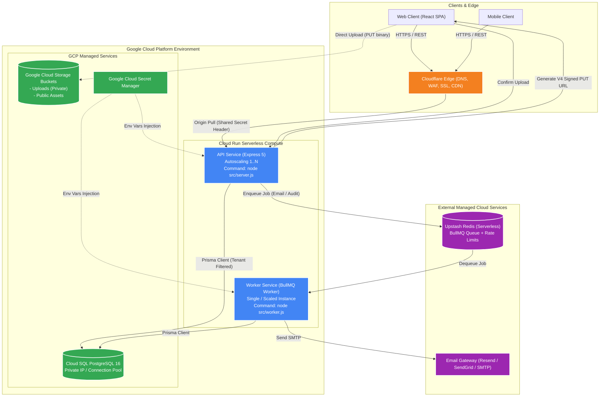
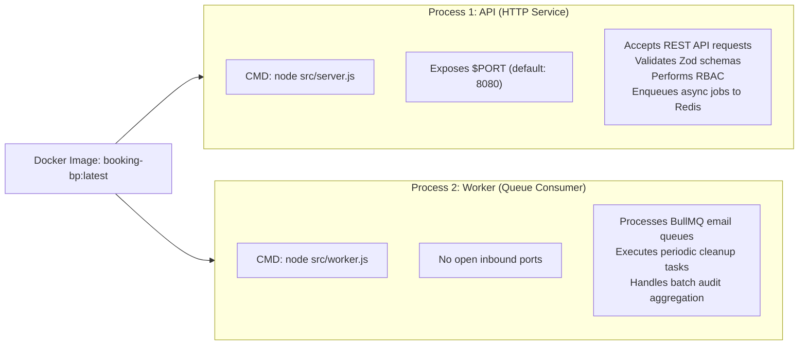

# Architectural Overview & Context

## 1. Executive Summary & Purpose

This repository houses the blueprint and architectural plan for an enterprise-ready, multi-tenant backend boilerplate tailored for booking, scheduling, and resource management applications. 

The system provides five foundational core modules:
1. **Multi-Tenancy & Onboarding**: Strict tenant isolation across shared database schemas with slug/subdomain/header context propagation.
2. **Auth & Identity**: Argon2id password hashing, rotating JWT refresh token sessions stored in PostgreSQL, cryptographic email verification, and password reset flows.
3. **Role-Based Access Control (RBAC)**: Fine-grained `resource:action` permission engine supporting system-level roles and tenant-customizable roles.
4. **Notifications & Asynchronous Email**: Dual-channel notification system (in-app notifications and BullMQ asynchronous email processing powered by Upstash Redis and Nodemailer).
5. **Media & File Storage**: Direct-to-storage architecture using Google Cloud Storage (GCS) V4 signed upload and download URLs, preventing API memory saturation.
6. **Audit & Activity Tracking**: Two-tier logging engine featuring an immutable append-only compliance audit log (with before/after state diffs) alongside a customer-facing activity feed.

All modules are designed to host a high-concurrency booking domain engine featuring PostgreSQL `tstzrange` exclusion constraints for mathematical double-booking prevention.

---

## 2. Decision Log & Technology Matrix

| Dimension | Decision | Rationale | Alternatives Considered |
| :--- | :--- | :--- | :--- |
| **Language & Runtime** | Node.js 22 LTS (Pure ECMAScript Modules `import/export`) | Native ESM, top-level await, stable high-performance HTTP server, aligned with modern V8 optimizations. | TypeScript (chosen plain JS per user requirement), Python/FastAPI, Go. |
| **Framework** | Express 5.x | Mature ecosystem, native async route error handling in v5, minimal runtime overhead, transparent middleware pipeline. | NestJS, Fastify, Koa. |
| **Database & ORM** | PostgreSQL 16 + Prisma ORM | Relational integrity, native JSONB, `btree_gist` exclusion constraints for bookings, Prisma Client Extensions for automatic tenant filtering. | TypeORM, Sequelize, Kysely, Drizzle. |
| **Tenancy Model** | Shared Database, Shared Schema (Tenant Column Isolation) | Cost-effective for SaaS, unified migrations, high tenant density, strong isolation via automated Prisma middleware. | Schema-per-tenant, Database-per-tenant. |
| **Cache & Queue** | Upstash Redis + BullMQ | Serverless Redis over TLS with standard Redis protocol compatibility, zero VPC peering complexity, zero idle cluster cost. | GCP Memorystore (higher fixed cost & requires VPC connector), RabbitMQ. |
| **File Storage** | Google Cloud Storage (GCS) with V4 Signed URLs | Offloads byte streaming from the Node.js API, scales infinitely, CDN-cachable via Cloudflare. Local dev uses `fake-gcs-server`. | AWS S3, Cloudflare R2, MinIO. |
| **Edge & CDN** | Cloudflare (DNS, WAF, SSL Full Strict, DDoS, Caching) | Unmetered DDoS mitigation, edge rate limiting, web application firewall rules, origin protection via secret headers. | Fastly, AWS CloudFront, GCP Cloud Armor. |
| **Containerization** | Multi-stage Docker (Alpine / Node 22 slim) | Unified single container image executable as either HTTP API or BullMQ Worker via entrypoint arguments. | Distroless, separate images per process. |
| **Cloud Hosting** | Google Cloud Run (Serverless Container Execution) | Scale-to-zero capability for staging, automated load balancing, zero server maintenance, native GCP IAM integration. | GKE (Kubernetes), Compute Engine VMs, AWS ECS Fargate. |
| **Scope Boundary** | **App-Only to Start** (Deferred Terraform & CI/CD) | Rapid development focusing on application logic, models, and Docker configuration first. Cloud infra blueprints documented for future phase. | Full Terraform + GitHub Actions upfront. |

---

## 3. High-Level System Architecture Diagram



---

## 4. Multi-Process Container Strategy

The codebase adheres strictly to the **12-Factor App methodology**. Both API and Worker processes share identical code dependencies and schemas, packaged into one production-grade Docker image.



---

## 5. Directory Layout & Organization

The repository structure follows a domain-driven modular format. Every business domain encapsulates its routes, controllers, services, repositories, and schemas:

```
booking-bp/
├── .env.example                     # Environment template with dummy variables
├── .dockerignore                    # Build optimization ignore rules
├── .gitignore                       # Git ignore rules
├── Dockerfile                       # Multi-stage production container
├── docker-compose.yml               # Local orchestration (PostgreSQL, fake-gcs, Mailpit)
├── package.json                     # Dependencies and scripts (ESM "type": "module")
├── README.md                        # Master documentation and quickstart index
├── prisma/
│   ├── schema.prisma                # Full PostgreSQL schema with multi-tenancy & indices
│   ├── seed.js                      # Database seeder (super-admin, default tenant, roles)
│   └── migrations/                  # Generated Prisma migration SQL files
├── docs/                            # In-depth architectural specifications
│   ├── 00-OVERVIEW.md               # This document
│   ├── 01-INFRASTRUCTURE-AND-DEPLOYMENT.md
│   ├── 02-DATABASE-AND-PRISMA-SCHEMA.md
│   ├── 03-CORE-MODULES-ARCHITECTURE.md
│   ├── 04-API-SPECIFICATION.md
│   ├── 05-DEFERRED-INFRASTRUCTURE-BLUEPRINT.md
│   └── 06-STEP-BY-STEP-IMPLEMENTATION-ROADMAP.md
├── src/
│   ├── app.js                       # Express app configuration & middleware pipeline
│   ├── server.js                    # HTTP entrypoint & graceful shutdown
│   ├── worker.js                    # BullMQ worker entrypoint & scheduled tasks
│   ├── config/                      # Validated environment configuration & logger
│   │   ├── env.js                   # Zod-validated process.env schema
│   │   └── logger.js                # Pino logger instance configured for GCP logging
│   ├── common/                      # Shared cross-cutting components
│   │   ├── database.js              # Prisma client instance with multi-tenant extension
│   │   ├── redis.js                 # Upstash Redis / ioredis connection pool
│   │   ├── errors/                  # Custom error classes (AppError, Unauthorized, etc.)
│   │   ├── middleware/              # Global Express middleware
│   │   │   ├── auth.middleware.js   # JWT authentication & session extraction
│   │   │   ├── rbac.middleware.js   # Permission & role validation guards
│   │   │   ├── tenant.middleware.js # Tenant resolution (slug, header, JWT)
│   │   │   ├── audit.middleware.js  # Automated mutation audit logger
│   │   │   ├── error.middleware.js  # Global centralized error handler
│   │   │   └── validate.middleware.js # Zod body/query/params validation
│   │   └── utils/                   # Crypto, pagination, date, token utilities
│   └── modules/                     # Domain modules
│       ├── health/                  # Health check endpoints (/healthz, /readyz)
│       ├── tenants/                 # Tenant lifecycle & settings
│       ├── auth/                    # Registration, login, tokens, password resets
│       ├── users/                   # User profiles & tenant-user assignment
│       ├── roles/                   # RBAC role & permission management
│       ├── notifications/           # In-app notifications & BullMQ email queuing
│       ├── files/                   # GCS signed URL generation & file metadata
│       └── audit/                   # Compliance audit logs & user activity feeds
└── tests/                           # Vitest / Supertest test suites
    ├── integration/                 # API endpoint integration tests
    ├── unit/                        # Domain logic and cryptographic unit tests
    └── isolation/                   # Multi-tenant data leak verification tests
```

---

## 6. Document Navigation

To inspect specific facets of the system in detail:
- **[01-INFRASTRUCTURE-AND-DEPLOYMENT.md](file:///home/sam/Code/main/backend-bp/booking-bp/docs/01-INFRASTRUCTURE-AND-DEPLOYMENT.md)**: Cloud Run, Cloudflare WAF, Upstash Redis, Docker, and local Docker Compose details.
- **[02-DATABASE-AND-PRISMA-SCHEMA.md](file:///home/sam/Code/main/backend-bp/booking-bp/docs/02-DATABASE-AND-PRISMA-SCHEMA.md)**: Complete database schema, Prisma definitions, tenant isolation extension, and booking constraint specifications.
- **[03-CORE-MODULES-ARCHITECTURE.md](file:///home/sam/Code/main/backend-bp/booking-bp/docs/03-CORE-MODULES-ARCHITECTURE.md)**: Deep dive into Auth, RBAC, Notifications, Files, Audit, and Tenancy modules.
- **[04-API-SPECIFICATION.md](file:///home/sam/Code/main/backend-bp/booking-bp/docs/04-API-SPECIFICATION.md)**: Full REST API endpoint reference, status codes, request/response bodies, and error formats.
- **[05-DEFERRED-INFRASTRUCTURE-BLUEPRINT.md](file:///home/sam/Code/main/backend-bp/booking-bp/docs/05-DEFERRED-INFRASTRUCTURE-BLUEPRINT.md)**: Terraform configurations and GitHub Actions CI/CD workflows flagged for later adoption.
- **[06-STEP-BY-STEP-IMPLEMENTATION-ROADMAP.md](file:///home/sam/Code/main/backend-bp/booking-bp/docs/06-STEP-BY-STEP-IMPLEMENTATION-ROADMAP.md)**: Sequential step-by-step development and verification plan.

