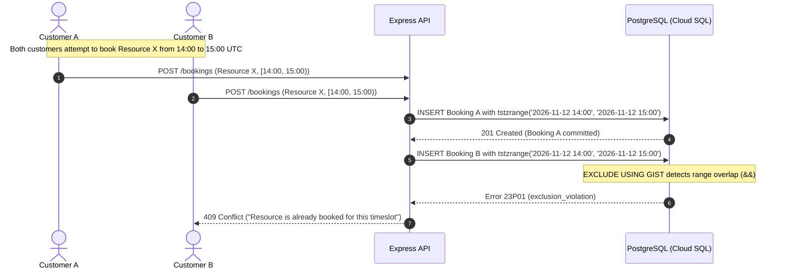

# Database & Prisma Schema Specification

## 1. Multi-Tenant Schema Architecture

The database architecture employs the **Shared Database, Shared Schema** model with strict row-level tenant column isolation. Every tenant-scoped entity contains a mandatory `tenantId` foreign key referencing the `Tenant` entity.

### 1.1 Isolation Principles
1. **Compound Uniqueness**: Identifiers that must be unique within a company (such as `email`, role `name`, resource `slug`) are enforced as compound unique constraints:
   `@@unique([tenantId, email])`
   This allows a user to register across multiple distinct tenants using the same email address while maintaining independent profiles, passwords, and permission sets per tenant.
2. **Compound Indexing**: All high-throughput queries are indexed by `(tenantId, <filterField>)` to guarantee index seek performance and prevent cross-tenant index scans:
   `@@index([tenantId, createdAt])`, `@@index([tenantId, status])`
3. **Foreign Key Cascades**: Deleting or suspending a tenant cascades appropriately to preserve referential integrity while preventing orphan records.

---

## 2. Complete Prisma Schema (`prisma/schema.prisma`)

```prisma
datasource db {
  provider   = "postgresql"
  url        = env("DATABASE_URL")
  extensions = [btree_gist]
}

generator client {
  provider        = "prisma-client-js"
  previewFeatures = ["postgresqlExtensions"]
}

// -------------------------------------------------------------
// ENUMS
// -------------------------------------------------------------

enum TenantStatus {
  ACTIVE
  SUSPENDED
  TRIALING
  DEACTIVATED
}

enum UserStatus {
  ACTIVE
  INACTIVE
  SUSPENDED
  PENDING_VERIFICATION
}

enum TokenType {
  EMAIL_VERIFICATION
  PASSWORD_RESET
  MAGIC_LINK
}

enum NotificationType {
  INFO
  SUCCESS
  WARNING
  ERROR
}

enum NotificationChannel {
  IN_APP
  EMAIL
  SMS
  PUSH
}

enum NotificationStatus {
  UNREAD
  READ
  ARCHIVED
}

enum EmailStatus {
  QUEUED
  SENT
  FAILED
  RETRYING
}

enum FileStatus {
  PENDING
  UPLOADED
  FAILED
  DELETED
}

enum ActorType {
  USER
  SYSTEM
  API_KEY
}

// -------------------------------------------------------------
// TENANTS & ORGANIZATIONS
// -------------------------------------------------------------

model Tenant {
  id          String       @id @default(uuid()) @db.Uuid
  name        String       @db.VarChar(100)
  slug        String       @unique @db.VarChar(50)
  status      TenantStatus @default(ACTIVE)
  settings    Json         @default("{}") @db.JsonB
  createdAt   DateTime     @default(now()) @map("created_at") @db.Timestamptz(6)
  updatedAt   DateTime     @updatedAt @map("updated_at") @db.Timestamptz(6)

  // Relationships
  users         User[]
  sessions      Session[]
  tokens        Token[]
  roles         Role[]
  userRoles     UserRole[]
  notifications Notification[]
  emailLogs     EmailLog[]
  files         File[]
  uploads       Upload[]
  auditLogs     AuditLog[]
  activities    Activity[]

  @@index([status])
  @@index([createdAt])
  @@map("tenants")
}

// -------------------------------------------------------------
// AUTH & USERS
// -------------------------------------------------------------

model User {
  id              String     @id @default(uuid()) @db.Uuid
  tenantId        String     @map("tenant_id") @db.Uuid
  email           String     @db.VarChar(255)
  passwordHash    String     @map("password_hash") @db.VarChar(255)
  firstName       String     @map("first_name") @db.VarChar(100)
  lastName        String     @map("last_name") @db.VarChar(100)
  phone           String?    @db.VarChar(50)
  avatarUrl       String?    @map("avatar_url") @db.VarChar(500)
  status          UserStatus @default(PENDING_VERIFICATION)
  emailVerifiedAt DateTime?  @map("email_verified_at") @db.Timestamptz(6)
  createdAt       DateTime   @default(now()) @map("created_at") @db.Timestamptz(6)
  updatedAt       DateTime   @updatedAt @map("updated_at") @db.Timestamptz(6)

  // Relationships
  tenant        Tenant         @relation(fields: [tenantId], references: [id], onDelete: Cascade)
  sessions      Session[]
  tokens        Token[]
  userRoles     UserRole[]
  notifications Notification[]
  files         File[]
  auditLogs     AuditLog[]     @relation("UserAuditLogs")
  activities    Activity[]

  @@unique([tenantId, email])
  @@index([tenantId, status])
  @@index([tenantId, createdAt])
  @@map("users")
}

model Session {
  id               String   @id @default(uuid()) @db.Uuid
  tenantId         String   @map("tenant_id") @db.Uuid
  userId           String   @map("user_id") @db.Uuid
  refreshTokenHash String   @map("refresh_token_hash") @db.VarChar(255)
  userAgent        String?  @map("user_agent") @db.VarChar(500)
  ipAddress        String?  @map("ip_address") @db.VarChar(45)
  isRevoked        Boolean  @default(false) @map("is_revoked")
  expiresAt        DateTime @map("expires_at") @db.Timestamptz(6)
  createdAt        DateTime @default(now()) @map("created_at") @db.Timestamptz(6)
  updatedAt        DateTime @updatedAt @map("updated_at") @db.Timestamptz(6)

  // Relationships
  tenant Tenant @relation(fields: [tenantId], references: [id], onDelete: Cascade)
  user   User   @relation(fields: [userId], references: [id], onDelete: Cascade)

  @@index([tenantId, userId])
  @@index([refreshTokenHash])
  @@index([expiresAt, isRevoked])
  @@map("sessions")
}

model Token {
  id        String    @id @default(uuid()) @db.Uuid
  tenantId  String    @map("tenant_id") @db.Uuid
  userId    String    @map("user_id") @db.Uuid
  tokenHash String    @map("token_hash") @db.VarChar(255)
  type      TokenType
  expiresAt DateTime  @map("expires_at") @db.Timestamptz(6)
  usedAt    DateTime? @map("used_at") @db.Timestamptz(6)
  createdAt DateTime  @default(now()) @map("created_at") @db.Timestamptz(6)

  // Relationships
  tenant Tenant @relation(fields: [tenantId], references: [id], onDelete: Cascade)
  user   User   @relation(fields: [userId], references: [id], onDelete: Cascade)

  @@index([tenantId, userId, type])
  @@index([tokenHash])
  @@index([expiresAt, usedAt])
  @@map("tokens")
}

// -------------------------------------------------------------
// ROLES & PERMISSIONS (RBAC)
// -------------------------------------------------------------

model Role {
  id          String   @id @default(uuid()) @db.Uuid
  tenantId    String?  @map("tenant_id") @db.Uuid // NULL for system-wide roles (Super Admin)
  name        String   @db.VarChar(100)
  description String?  @db.VarChar(255)
  isSystem    Boolean  @default(false) @map("is_system")
  createdAt   DateTime @default(now()) @map("created_at") @db.Timestamptz(6)
  updatedAt   DateTime @updatedAt @map("updated_at") @db.Timestamptz(6)

  // Relationships
  tenant          Tenant?          @relation(fields: [tenantId], references: [id], onDelete: Cascade)
  rolePermissions RolePermission[]
  userRoles       UserRole[]

  @@unique([tenantId, name])
  @@index([tenantId])
  @@map("roles")
}

model Permission {
  id          String   @id @default(uuid()) @db.Uuid
  resource    String   @db.VarChar(50)  // e.g. "users", "bookings", "files"
  action      String   @db.VarChar(50)  // e.g. "read", "create", "delete"
  description String?  @db.VarChar(255)
  createdAt   DateTime @default(now()) @map("created_at") @db.Timestamptz(6)

  // Relationships
  rolePermissions RolePermission[]

  @@unique([resource, action])
  @@index([resource])
  @@map("permissions")
}

model RolePermission {
  roleId       String @map("role_id") @db.Uuid
  permissionId String @map("permission_id") @db.Uuid

  // Relationships
  role       Role       @relation(fields: [roleId], references: [id], onDelete: Cascade)
  permission Permission @relation(fields: [permissionId], references: [id], onDelete: Cascade)

  @@id([roleId, permissionId])
  @@map("role_permissions")
}

model UserRole {
  id        String   @id @default(uuid()) @db.Uuid
  tenantId  String   @map("tenant_id") @db.Uuid
  userId    String   @map("user_id") @db.Uuid
  roleId    String   @map("role_id") @db.Uuid
  createdAt DateTime @default(now()) @map("created_at") @db.Timestamptz(6)

  // Relationships
  tenant Tenant @relation(fields: [tenantId], references: [id], onDelete: Cascade)
  user   User   @relation(fields: [userId], references: [id], onDelete: Cascade)
  role   Role   @relation(fields: [roleId], references: [id], onDelete: Cascade)

  @@unique([tenantId, userId, roleId])
  @@index([tenantId, userId])
  @@map("user_roles")
}

// -------------------------------------------------------------
// NOTIFICATIONS & EMAILS
// -------------------------------------------------------------

model Notification {
  id        String              @id @default(uuid()) @db.Uuid
  tenantId  String              @map("tenant_id") @db.Uuid
  userId    String              @map("user_id") @db.Uuid
  title     String              @db.VarChar(200)
  message   String              @db.Text
  type      NotificationType    @default(INFO)
  channel   NotificationChannel @default(IN_APP)
  status    NotificationStatus  @default(UNREAD)
  readAt    DateTime?           @map("read_at") @db.Timestamptz(6)
  metadata  Json                @default("{}") @db.JsonB
  createdAt DateTime            @default(now()) @map("created_at") @db.Timestamptz(6)

  // Relationships
  tenant Tenant @relation(fields: [tenantId], references: [id], onDelete: Cascade)
  user   User   @relation(fields: [userId], references: [id], onDelete: Cascade)

  @@index([tenantId, userId, status])
  @@index([tenantId, createdAt])
  @@map("notifications")
}

model EmailLog {
  id         String      @id @default(uuid()) @db.Uuid
  tenantId   String      @map("tenant_id") @db.Uuid
  recipient  String      @db.VarChar(255)
  subject    String      @db.VarChar(255)
  template   String      @db.VarChar(100)
  status     EmailStatus @default(QUEUED)
  providerId String?     @map("provider_id") @db.VarChar(100)
  error      String?     @db.Text
  retries    Int         @default(0)
  sentAt     DateTime?   @map("sent_at") @db.Timestamptz(6)
  createdAt  DateTime    @default(now()) @map("created_at") @db.Timestamptz(6)

  // Relationships
  tenant Tenant @relation(fields: [tenantId], references: [id], onDelete: Cascade)

  @@index([tenantId, status])
  @@index([tenantId, createdAt])
  @@map("email_logs")
}

// -------------------------------------------------------------
// MEDIA & FILES
// -------------------------------------------------------------

model File {
  id           String     @id @default(uuid()) @db.Uuid
  tenantId     String     @map("tenant_id") @db.Uuid
  uploaderId   String     @map("uploader_id") @db.Uuid
  key          String     @db.VarChar(500)
  originalName String     @map("original_name") @db.VarChar(255)
  mimeType     String     @map("mime_type") @db.VarChar(100)
  sizeBytes    BigInt     @map("size_bytes")
  bucket       String     @db.VarChar(100)
  isPublic     Boolean    @default(false) @map("is_public")
  status       FileStatus @default(PENDING)
  metadata     Json       @default("{}") @db.JsonB
  createdAt    DateTime   @default(now()) @map("created_at") @db.Timestamptz(6)
  updatedAt    DateTime   @updatedAt @map("updated_at") @db.Timestamptz(6)

  // Relationships
  tenant  Tenant   @relation(fields: [tenantId], references: [id], onDelete: Cascade)
  user    User     @relation(fields: [uploaderId], references: [id], onDelete: Cascade)
  uploads Upload[]

  @@unique([tenantId, key])
  @@index([tenantId, status])
  @@index([tenantId, createdAt])
  @@map("files")
}

model Upload {
  id        String     @id @default(uuid()) @db.Uuid
  tenantId  String     @map("tenant_id") @db.Uuid
  fileId    String     @map("file_id") @db.Uuid
  uploadUrl String     @map("upload_url") @db.Text
  expiresAt DateTime   @map("expires_at") @db.Timestamptz(6)
  status    FileStatus @default(PENDING)
  createdAt DateTime   @default(now()) @map("created_at") @db.Timestamptz(6)

  // Relationships
  tenant Tenant @relation(fields: [tenantId], references: [id], onDelete: Cascade)
  file   File   @relation(fields: [fileId], references: [id], onDelete: Cascade)

  @@index([tenantId, fileId])
  @@index([expiresAt, status])
  @@map("uploads")
}

// -------------------------------------------------------------
// AUDIT LOGS & ACTIVITIES
// -------------------------------------------------------------

model AuditLog {
  id        String    @id @default(uuid()) @db.Uuid
  tenantId  String    @map("tenant_id") @db.Uuid
  actorId   String?   @map("actor_id") @db.Uuid
  actorType ActorType @default(USER) @map("actor_type")
  action    String    @db.VarChar(100) // e.g. "user.created", "role.updated"
  entity    String    @db.VarChar(50)  // e.g. "User", "Role", "Booking"
  entityId  String    @map("entity_id") @db.VarChar(100)
  oldValues Json?     @map("old_values") @db.JsonB
  newValues Json?     @map("new_values") @db.JsonB
  ipAddress String?   @map("ip_address") @db.VarChar(45)
  userAgent String?   @map("user_agent") @db.VarChar(500)
  createdAt DateTime  @default(now()) @map("created_at") @db.Timestamptz(6)

  // Relationships
  tenant Tenant @relation(fields: [tenantId], references: [id], onDelete: Cascade)
  user   User?  @relation("UserAuditLogs", fields: [actorId], references: [id], onDelete: SetNull)

  @@index([tenantId, entity, entityId])
  @@index([tenantId, action])
  @@index([tenantId, createdAt])
  @@map("audit_logs")
}

model Activity {
  id        String   @id @default(uuid()) @db.Uuid
  tenantId  String   @map("tenant_id") @db.Uuid
  userId    String   @map("user_id") @db.Uuid
  action    String   @db.VarChar(100)
  summary   String   @db.VarChar(255)
  metadata  Json     @default("{}") @db.JsonB
  createdAt DateTime @default(now()) @map("created_at") @db.Timestamptz(6)

  // Relationships
  tenant Tenant @relation(fields: [tenantId], references: [id], onDelete: Cascade)
  user   User   @relation(fields: [userId], references: [id], onDelete: Cascade)

  @@index([tenantId, userId])
  @@index([tenantId, createdAt])
  @@map("activities")
}
```

---

## 3. Future Booking Domain Integration & Double-Booking Guard

When the booking domain entities (`Resource`, `Availability`, `Booking`) are introduced to this boilerplate, concurrency safety is guaranteed at the PostgreSQL engine level using exclusion constraints.



### 3.1 Migration SQL for Booking Exclusion Constraint
In raw PostgreSQL:
```sql
CREATE EXTENSION IF NOT EXISTS btree_gist;

CREATE TABLE bookings (
    id UUID PRIMARY KEY DEFAULT gen_random_uuid(),
    tenant_id UUID NOT NULL REFERENCES tenants(id) ON DELETE CASCADE,
    resource_id UUID NOT NULL REFERENCES resources(id) ON DELETE CASCADE,
    customer_id UUID NOT NULL REFERENCES users(id) ON DELETE CASCADE,
    time_range TSTZRANGE NOT NULL,
    status VARCHAR(50) NOT NULL DEFAULT 'CONFIRMED',
    created_at TIMESTAMPTZ(6) NOT NULL DEFAULT NOW(),
    
    -- Hardware-level guarantee against double bookings:
    CONSTRAINT no_overlapping_bookings 
    EXCLUDE USING gist (
        tenant_id WITH =,
        resource_id WITH =,
        time_range WITH &&
    ) WHERE (status NOT IN ('CANCELLED', 'REJECTED'))
);
```

---

## 4. Prisma Client Multi-Tenant Extension

To guarantee that application developers never inadvertently leak data across tenants, we implement a Prisma Client extension. This automatically injects `where: { tenantId }` into all queries and attaches `data: { tenantId }` on all creates.

```javascript
// In common/database.js
import { PrismaClient } from '@prisma/client';

const rawPrisma = new PrismaClient({
  log: process.env.NODE_ENV === 'development' ? ['query', 'error', 'warn'] : ['error']
});

export function getTenantPrisma(tenantId) {
  if (!tenantId) {
    throw new Error('Tenant context is required for database operations.');
  }

  return rawPrisma.$extends({
    query: {
      $allModels: {
        async findMany({ args, query }) {
          args.where = { ...args.where, tenantId };
          return query(args);
        },
        async findFirst({ args, query }) {
          args.where = { ...args.where, tenantId };
          return query(args);
        },
        async create({ args, query }) {
          args.data = { ...args.data, tenantId };
          return query(args);
        },
        async updateMany({ args, query }) {
          args.where = { ...args.where, tenantId };
          return query(args);
        },
        async deleteMany({ args, query }) {
          args.where = { ...args.where, tenantId };
          return query(args);
        }
      }
    }
  });
}

// Global un-scoped instance reserved exclusively for Super Admin & system tasks
export const systemPrisma = rawPrisma;
```

