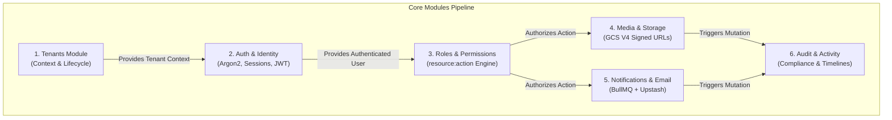
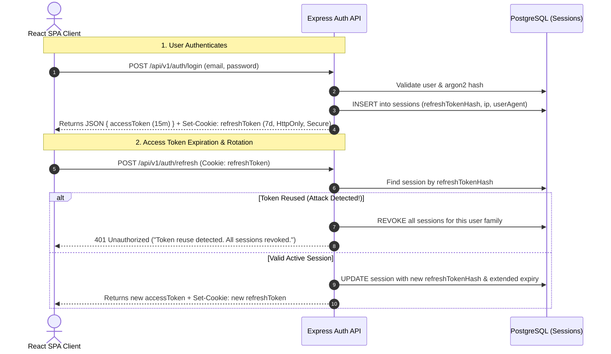
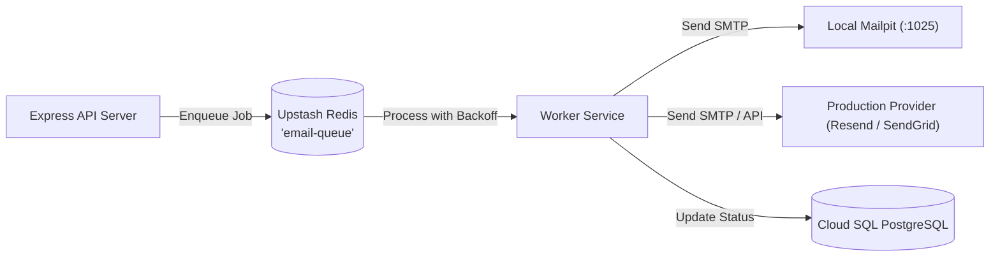
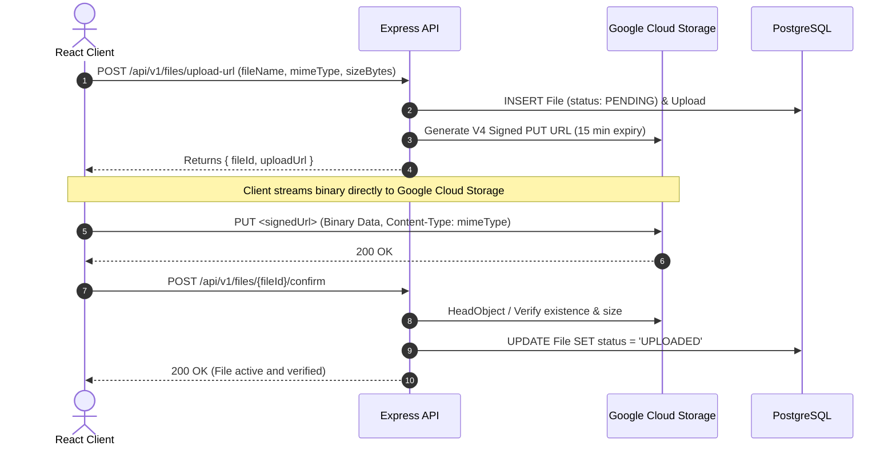

# Core Modules Architecture Specification

## 1. Domain Overview & Modular Boundaries

The backend adopts a domain-driven modular monolith pattern. Each module encapsulates its controllers, services, repositories, and Zod schemas, interacting with other modules via clean programmatic boundaries or asynchronous queues.



---

## 2. Module 1: Tenancy (`src/modules/tenants`)

### 2.1 Resolution Hierarchy
Every incoming HTTP request is resolved to a specific tenant context via the following prioritized hierarchy in `tenant.middleware.js`:
1. **Subdomain Extraction**: If accessing via a vanity subdomain (e.g., `acme.bookingapp.com`), the subdomain `acme` is looked up against `Tenant.slug`.
2. **Explicit Header**: API clients or mobile apps can supply `X-Tenant-Slug` or `X-Tenant-ID`.
3. **JWT Authenticated Claim**: If an access token is present, the verified `tenantId` claim takes precedence.
4. **Default Tenant**: If no tenant is provided and the environment permits, resolves to the default system tenant.

### 2.2 Execution Context
The resolved tenant is bound to the request object (`req.tenant`) and made available to down-stream services:
```javascript
// In common/middleware/tenant.middleware.js
export async function resolveTenant(req, res, next) {
  const slug = req.headers['x-tenant-slug'] || extractSubdomain(req.hostname);
  
  if (slug) {
    const tenant = await systemPrisma.tenant.findUnique({ where: { slug } });
    if (!tenant || tenant.status !== 'ACTIVE') {
      return res.status(404).json({ error: 'Tenant not found or inactive.' });
    }
    req.tenant = tenant;
    return next();
  }
  
  // If request has verified auth token, tenant is extracted from token
  if (req.user?.tenantId) {
    req.tenant = { id: req.user.tenantId };
    return next();
  }

  next();
}
```

---

## 3. Module 2: Auth & Identity (`src/modules/auth` & `src/modules/users`)

### 3.1 Cryptographic Password Security
- Passwords are encrypted using **Argon2id** (winner of the Password Hashing Competition) with the following OWASP-compliant parameters:
  - Memory cost: `65536` KiB (64 MB)
  - Time cost: `3` iterations
  - Parallelism: `4` threads
- Password constraints (enforced via Zod): Minimum 8 characters, at least 1 uppercase letter, 1 lowercase letter, 1 number, and 1 special symbol.

### 3.2 Dual-Token Architecture


### 3.3 Token Theft & Reuse Detection
The refresh token mechanism tracks session families. If a previously rotated refresh token is presented again (indicating potential man-in-the-middle theft), the system flags a breach and immediately invalidates all active sessions for that user.

### 3.4 Verification & Password Reset Flows
1. **Email Verification**:
   - Generates a 32-byte cryptographic random hex token.
   - Computes SHA-256 hash of the token and stores it in the `Token` table (`type: EMAIL_VERIFICATION`, 24h expiry).
   - Enqueues an email job to BullMQ containing the verification link with the raw token.
2. **Password Reset**:
   - Generates a 32-byte token with a 1-hour expiry.
   - Upon successful verification and password update, all existing `Session` records for that user are revoked.

---

## 4. Module 3: Roles & Permissions (`src/modules/roles`)

### 4.1 Permission Syntax
Permissions follow the granular `<resource>:<action>` convention. Wildcards are supported:
- `users:read`, `users:create`, `users:update`, `users:delete`
- `roles:manage`, `files:upload`, `audit:read`
- `*` (Global super-admin wildcard)
- `bookings:*` (All actions on booking resources)

### 4.2 Built-in Role Catalog
| Role Name | Scope | Description | Permissions Granted |
| :--- | :--- | :--- | :--- |
| `SUPER_ADMIN` | Global (`tenantId: null`) | System platform owner. Cross-tenant access. | `*` (All permissions) |
| `TENANT_ADMIN` | Tenant-scoped | Organization administrator. | Full access to tenant's users, roles, files, audit, bookings. |
| `TENANT_MEMBER`| Tenant-scoped | Staff / service providers. | Read/write bookings, read users, upload files. |
| `TENANT_CUSTOMER` | Tenant-scoped | End-users booking services. | Manage own profile, create/view own bookings. |

### 4.3 Authorization Middleware Guard
```javascript
// In common/middleware/rbac.middleware.js
export function requirePermission(...requiredPermissions) {
  return async (req, res, next) => {
    if (!req.user) return res.status(401).json({ error: 'Unauthenticated.' });

    const userPermissions = req.user.permissions; // Loaded during session verification

    // Super Admin override
    if (userPermissions.includes('*')) return next();

    const hasAll = requiredPermissions.every((perm) => {
      const [resource, action] = perm.split(':');
      return (
        userPermissions.includes(perm) ||
        userPermissions.includes(`${resource}:*`)
      );
    });

    if (!hasAll) {
      return res.status(403).json({
        error: 'Forbidden: Insufficient permissions.',
        required: requiredPermissions
      });
    }

    next();
  };
}
```

---

## 5. Module 4: Notifications & Email (`src/modules/notifications`)

### 5.1 BullMQ & Upstash Queue Architecture
Background jobs are queued using BullMQ backed by Upstash Redis. The Express API acts purely as a producer, while the dedicated worker service consumes jobs.



### 5.2 Worker Processor & Retry Strategy
```javascript
// In modules/notifications/email.worker.js
import { Worker } from 'bullmq';
import { redisConnection } from '../../common/redis.js';
import { sendMail } from './email.service.js';
import { systemPrisma } from '../../common/database.js';

export const emailWorker = new Worker(
  'email-queue',
  async (job) => {
    const { emailLogId, to, subject, html } = job.data;
    try {
      const result = await sendMail({ to, subject, html });
      await systemPrisma.emailLog.update({
        where: { id: emailLogId },
        data: { status: 'SENT', sentAt: new Date(), providerId: result.messageId }
      });
    } catch (error) {
      await systemPrisma.emailLog.update({
        where: { id: emailLogId },
        data: { status: 'FAILED', error: error.message, retries: job.attemptsMade }
      });
      throw error; // Re-throw to trigger BullMQ exponential backoff
    }
  },
  {
    connection: redisConnection,
    concurrency: 5,
    limiter: { max: 20, duration: 1000 } // Rate limit: max 20 emails/second
  }
);
```

### 5.3 In-App Notification Hub
- Notifications are persisted to the `Notification` table with read status tracking (`UNREAD`, `READ`, `ARCHIVED`).
- Endpoints allow fetching unread counts (`GET /api/v1/notifications/unread-count`), querying paged notifications, and bulk marking as read.
- Readily extensible to Server-Sent Events (SSE) or WebSockets without schema modifications.

---

## 6. Module 5: Media & Storage (`src/modules/files`)

### 6.1 Direct-to-Storage Two-Phase Upload
To guarantee high performance and avoid Cloud Run payload size limits and memory bloat, raw file bytes are never proxied through the Express server.



### 6.2 Signed Download URL Generation
For private files, clients request a time-limited download URL:
```javascript
export async function getFileDownloadUrl(fileKey, expiresInSeconds = 900) {
  const [url] = await storage
    .bucket(env.GCS_BUCKET_PRIVATE)
    .file(fileKey)
    .getSignedUrl({
      version: 'v4',
      action: 'read',
      expires: Date.now() + expiresInSeconds * 1000
    });
  return url;
}
```

---

## 7. Module 6: Audit & Activity Tracking (`src/modules/audit`)

### 7.1 Two-Tier Architecture
1. **Compliance Audit Log (`AuditLog`)**:
   - Tracks all administrative state mutations (`POST`, `PUT`, `PATCH`, `DELETE`).
   - Captures: Actor identity, Actor type, Entity modified, Entity ID, IP address, User Agent, and full Before/After JSON diffs.
   - Append-only table. Partitioned by date in high-scale deployments.
2. **Customer Activity Feed (`Activity`)**:
   - Human-readable event timeline for display on frontend dashboards (e.g. *"Sarah Connor booked Studio Room A for tomorrow at 2:00 PM"*).

### 7.2 Express Audit Middleware
```javascript
// In common/middleware/audit.middleware.js
export function auditLog(actionName, entityType) {
  return async (req, res, next) => {
    const originalJson = res.json.bind(res);
    res.json = function (body) {
      res.locals.responseBody = body;
      return originalJson(body);
    };

    res.on('finish', async () => {
      if (res.statusCode >= 200 && res.statusCode < 300 && req.user) {
        try {
          await systemPrisma.auditLog.create({
            data: {
              tenantId: req.user.tenantId,
              actorId: req.user.id,
              actorType: 'USER',
              action: actionName,
              entity: entityType,
              entityId: req.params.id || res.locals.responseBody?.data?.id || 'unknown',
              newValues: req.body,
              ipAddress: req.ip,
              userAgent: req.get('user-agent')
            }
          });
        } catch (err) {
          logger.error('Failed to write audit log:', err);
        }
      }
    });

    next();
  };
}
```

---

## 8. Cross-Cutting Middleware Standards

### 8.1 Validation with Zod
Requests are validated using a reusable Zod wrapper:
```javascript
export const validate = (schema) => async (req, res, next) => {
  try {
    if (schema.body) req.body = await schema.body.parseAsync(req.body);
    if (schema.query) req.query = await schema.query.parseAsync(req.query);
    if (schema.params) req.params = await schema.params.parseAsync(req.params);
    next();
  } catch (error) {
    return res.status(400).json({
      error: 'Validation failed',
      details: error.errors.map((e) => ({ path: e.path.join('.'), message: e.message }))
    });
  }
};
```

### 8.2 Centralized Error Handler
All uncaught exceptions funnel into `error.middleware.js`:
- Maps known errors (`AppError`, Prisma errors, Zod errors) to HTTP status codes.
- Sanitizes stack traces in production to prevent information disclosure.
- Emits structured JSON logs via Pino with trace IDs for Google Cloud Error Reporting.

