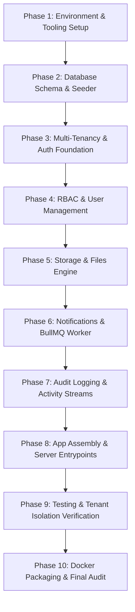

# Step-by-Step Implementation Roadmap

## 1. Overview & Phasing Strategy

This roadmap details the sequential execution phases required to build the multi-tenant booking backend boilerplate from an empty workspace to a fully tested, containerized, production-ready system.

---

## 2. Phase Breakdown

### Phase 1: Environment & Tooling Setup
- **Goal**: Establish project configuration, dependencies, environment validation, logging, and local container orchestration.
- **Tasks**:
  1. Initialize `package.json` with ESM configuration (`"type": "module"`), development scripts, and production dependencies.
  2. Implement `docker-compose.yml` running PostgreSQL 16, `fake-gcs-server`, `mailpit`, and local `redis`.
  3. Create `.env.example` documenting all configuration keys.
  4. Write `src/config/env.js` utilizing Zod to validate all required environment variables on process boot.
  5. Implement `src/config/logger.js` utilizing Pino, configured for Google Cloud Logging JSON schema.
  6. Create common error hierarchy (`AppError`, `NotFoundError`, `UnauthorizedError`, `ForbiddenError`, `ConflictError`, `ValidationError`).
  7. Implement `error.middleware.js` and `validate.middleware.js`.
- **Exit Criteria**: Running `npm run dev` boots successfully, validates environment variables, and fails gracefully with clear error output if any configuration is missing.

---

### Phase 2: Database Schema & Seeder
- **Goal**: Configure Prisma ORM with PostgreSQL, execute initial migrations, and seed the default platform state.
- **Tasks**:
  1. Write `prisma/schema.prisma` with all models, compound indices, and relations.
  2. Run initial database migration against local PostgreSQL (`npx prisma migrate dev --name init`).
  3. Author `prisma/seed.js`:
     - Creates the system permissions catalog (`users:*`, `roles:*`, `files:*`, `notifications:*`, `audit:*`, `bookings:*`).
     - Provisions built-in roles (`SUPER_ADMIN`, `TENANT_ADMIN`, `TENANT_MEMBER`, `TENANT_CUSTOMER`).
     - Provisions the initial Default Tenant (`slug: "default"`).
     - Provisions the bootstrap Super Admin user with an Argon2id hashed password.
- **Exit Criteria**: `npx prisma db seed` runs idempotently without errors, populating all reference and administrative data.

---

### Phase 3: Multi-Tenancy & Auth Foundation
- **Goal**: Implement tenant isolation at the data layer and complete the end-to-end authentication lifecycle.
- **Tasks**:
  1. Create `src/common/database.js` implementing the Prisma Client Extension that injects `tenantId` into queries.
  2. Implement `src/common/middleware/tenant.middleware.js` to resolve tenant context from subdomains, headers, or tokens.
  3. Implement `src/modules/auth/auth.service.js`:
     - Password hashing with Argon2id.
     - JWT access token generation (15-minute lifespan).
     - Cryptographic refresh token issuance and rotation with token-reuse breach detection.
     - Verification token generation and password reset workflows.
  4. Implement `src/common/middleware/auth.middleware.js` to verify JWTs, check session validity in the database, and bind user context.
  5. Author controllers, routes, and Zod schemas for `/api/v1/auth/*`.
- **Exit Criteria**: User can register, receive a verification token, log in, exchange refresh tokens, and log out with database session revocation.

---

### Phase 4: RBAC & User Management
- **Goal**: Implement fine-grained permission authorization and administrative user management.
- **Tasks**:
  1. Implement `src/common/middleware/rbac.middleware.js` providing `requirePermission(...)` and `requireRole(...)`.
  2. Implement `src/modules/roles/`:
     - Role creation, updates, and permission bindings.
     - Validation ensuring system roles cannot be deleted or mutated by tenant admins.
  3. Implement `src/modules/users/`:
     - Paged listing, profile management, status toggling, and role assignments.
- **Exit Criteria**: Unauthorized users receive `403 Forbidden` when attempting protected administrative actions.

---

### Phase 5: Storage & Files Engine
- **Goal**: Build direct-to-storage file uploading using Google Cloud Storage V4 signed URLs.
- **Tasks**:
  1. Implement `src/modules/files/storage.service.js` using `@google-cloud/storage`, supporting both production GCS and local `fake-gcs-server`.
  2. Implement V4 Signed PUT URL generator for direct binary upload.
  3. Implement upload confirmation endpoint that verifies uploaded object metadata in GCS before marking `File` as active.
  4. Implement V4 Signed GET URL generator for private downloads.
- **Exit Criteria**: Client can acquire a signed URL, upload a binary payload directly to GCS/fake-gcs, confirm the upload, and retrieve a signed download URL.

---

### Phase 6: Notifications & BullMQ Worker
- **Goal**: Build asynchronous email dispatch and in-app notification tracking.
- **Tasks**:
  1. Implement `src/common/redis.js` managing Upstash Redis connection pooling for BullMQ.
  2. Implement `src/modules/notifications/email.service.js` with Nodemailer (routing to Mailpit locally or SMTP in production).
  3. Implement `src/modules/notifications/email.worker.js` with exponential backoff and error tracking in `EmailLog`.
  4. Implement in-app notification queries, unread count endpoints, and mark-as-read handlers.
  5. Author `src/worker.js` entrypoint to execute BullMQ queue workers.
- **Exit Criteria**: Triggering a registration enqueues an email job, the worker processes it, Mailpit receives the HTML message, and the `email_logs` table records a `SENT` status.

---

### Phase 7: Audit Logging & Activity Streams
- **Goal**: Implement automated compliance audit logging and customer activity feeds.
- **Tasks**:
  1. Implement `src/common/middleware/audit.middleware.js` intercepting state mutations and recording JSON diffs to `AuditLog`.
  2. Implement user-facing `Activity` helper service to log readable business milestones.
  3. Build administrative query endpoints (`/api/v1/audit/logs`, `/api/v1/audit/activities`).
- **Exit Criteria**: All state-modifying API requests automatically create audit log records with actor, IP, timestamp, and diff payload.

---

### Phase 8: App Assembly & Server Entrypoints
- **Goal**: Wire all modules into the main Express application and implement graceful shutdown handling.
- **Tasks**:
  1. Implement `src/modules/health/` (`/healthz` and `/readyz`).
  2. Assemble `src/app.js` with Helmet, CORS, cookie-parser, JSON parsing, logging, and rate limiting.
  3. Author `src/server.js` listening on `$PORT` with `SIGTERM` / `SIGINT` signal listeners that close HTTP listeners, BullMQ queues, and Prisma connections gracefully.
- **Exit Criteria**: Cloud Run readiness and liveness endpoints return `200 OK`.

---

### Phase 9: Testing & Tenant Isolation Verification
- **Goal**: Ensure test coverage across core flows and rigorously verify zero tenant cross-contamination.
- **Tasks**:
  1. Setup Vitest test runner with Supertest.
  2. Write unit tests for cryptographic functions, Argon2 hashing, and permission checks.
  3. Write integration tests for auth lifecycles and role management.
  4. **Write strict tenant isolation test**: Create Tenant A and Tenant B; assert that Tenant A users cannot query, modify, or delete Tenant B's data under any condition.
- **Exit Criteria**: 100% test pass rate across unit, integration, and isolation suites.

---

### Phase 10: Docker Packaging & Readiness Audit
- **Goal**: Build the production Docker image and verify that both API and Worker processes run cleanly in containerized mode.
- **Tasks**:
  1. Author multi-stage `Dockerfile`.
  2. Verify image build with non-root security context.
  3. Verify `docker run <image> node src/server.js` boots the API.
  4. Verify `docker run <image> node src/worker.js` boots the Worker.
- **Exit Criteria**: Container starts, connects to dependencies, and passes health probes.

