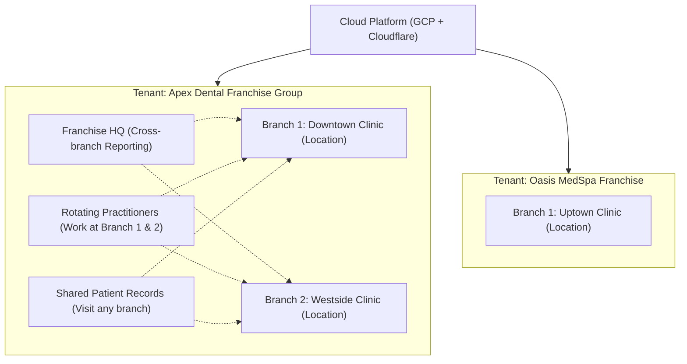
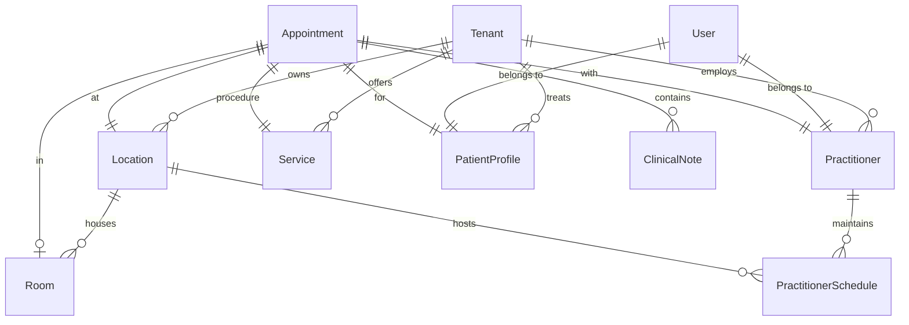
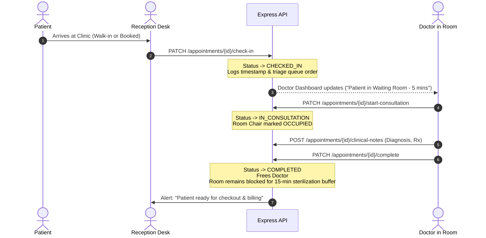

# Clinic Franchise Steering Plan: From Boilerplate to Health-Tech SaaS

This document outlines the exact architectural roadmap, schema extensions, and business logic needed to steer our current backend boilerplate into an enterprise-grade **Multi-Tenant Clinic & Healthcare Franchise Platform**.

---

## 1. Franchise Architectural Decision: Hybrid Hierarchy

To support both **independent clinic franchisees** and **multi-branch chains**, we adopt the **Franchise Group + Branch** model:



### Why this model wins:
1. **Single Patient Profile across the franchise**: A patient visiting Branch A doesn't have to fill out new registration forms when visiting Branch B.
2. **Rotating Practitioners**: Specialists can practice at Downtown on Mondays/Wednesdays and Westside on Tuesdays/Thursdays.
3. **Franchise-Level Analytics**: Franchise HQ tracks revenue, no-show rates, and treatment volumes across all locations in one view.

---

## 2. Database Schema Extensions (Prisma Additions)

Below is the concrete schema to layer on top of our existing `prisma/schema.prisma`. It reuses our existing `Tenant`, `User`, `File`, and `AuditLog` models without breaking changes.



### 2.1 Concrete Prisma Schema Additions

```prisma
// -------------------------------------------------------------
// CLINIC LOCATIONS & INFRASTRUCTURE
// -------------------------------------------------------------

model Location {
  id          String   @id @default(uuid()) @db.Uuid
  tenantId    String   @map("tenant_id") @db.Uuid
  name        String   @db.VarChar(100) // e.g. "Downtown Dental Care"
  slug        String   @db.VarChar(50)  // e.g. "downtown"
  address     String   @db.Text
  phone       String   @db.VarChar(50)
  timezone    String   @default("UTC") @db.VarChar(50)
  isActive    Boolean  @default(true) @map("is_active")
  createdAt   DateTime @default(now()) @map("created_at") @db.Timestamptz(6)

  tenant       Tenant                 @relation(fields: [tenantId], references: [id], onDelete: Cascade)
  rooms        Room[]
  schedules    PractitionerSchedule[]
  appointments Appointment[]

  @@unique([tenantId, slug])
  @@index([tenantId, isActive])
  @@map("locations")
}

model Room {
  id         String   @id @default(uuid()) @db.Uuid
  tenantId   String   @map("tenant_id") @db.Uuid
  locationId String   @map("location_id") @db.Uuid
  name       String   @db.VarChar(50)  // e.g. "Treatment Chair 1", "Ultrasound Room"
  type       String   @db.VarChar(50)  // "EXAM", "SURGERY", "CHAIR"
  isActive   Boolean  @default(true) @map("is_active")

  location     Location      @relation(fields: [locationId], references: [id], onDelete: Cascade)
  appointments Appointment[]

  @@index([tenantId, locationId])
  @@map("rooms")
}

// -------------------------------------------------------------
// PRACTITIONERS & CLINICAL SERVICES
// -------------------------------------------------------------

model Practitioner {
  id            String   @id @default(uuid()) @db.Uuid
  tenantId      String   @map("tenant_id") @db.Uuid
  userId        String   @unique @map("user_id") @db.Uuid
  licenseNumber String   @map("license_number") @db.VarChar(100)
  specialty     String   @db.VarChar(100) // e.g. "Orthodontics", "General Practice"
  bio           String?  @db.Text
  colorCode     String   @default("#2563eb") @map("color_code") @db.VarChar(10) // Calendar color

  user         User                   @relation(fields: [userId], references: [id], onDelete: Cascade)
  schedules    PractitionerSchedule[]
  appointments Appointment[]

  @@index([tenantId])
  @@map("practitioners")
}

model PractitionerSchedule {
  id             String   @id @default(uuid()) @db.Uuid
  tenantId       String   @map("tenant_id") @db.Uuid
  practitionerId String   @map("practitioner_id") @db.Uuid
  locationId     String   @map("location_id") @db.Uuid
  dayOfWeek      Int      @map("day_of_week") // 0 = Sunday, 1 = Monday ... 6 = Saturday
  startTime      String   @map("start_time") @db.VarChar(5) // "09:00"
  endTime        String   @map("end_time") @db.VarChar(5)   // "17:00"
  isActive       Boolean  @default(true) @map("is_active")

  practitioner Practitioner @relation(fields: [practitionerId], references: [id], onDelete: Cascade)
  location     Location     @relation(fields: [locationId], references: [id], onDelete: Cascade)

  @@index([tenantId, practitionerId, locationId])
  @@map("practitioner_schedules")
}

model Service {
  id              String   @id @default(uuid()) @db.Uuid
  tenantId        String   @map("tenant_id") @db.Uuid
  name            String   @db.VarChar(100) // e.g. "Root Canal Therapy"
  durationMinutes Int      @map("duration_minutes") // e.g. 45
  bufferMinutes   Int      @default(15) @map("buffer_minutes") // Sanitization buffer
  priceCents      Int      @map("price_cents") // Currency in cents
  isActive        Boolean  @default(true) @map("is_active")

  appointments Appointment[]

  @@index([tenantId, isActive])
  @@map("services")
}

// -------------------------------------------------------------
// PATIENTS & MEDICAL PROFILES
// -------------------------------------------------------------

model PatientProfile {
  id               String    @id @default(uuid()) @db.Uuid
  tenantId         String    @map("tenant_id") @db.Uuid
  userId           String    @unique @map("user_id") @db.Uuid
  dateOfBirth      DateTime? @map("date_of_birth") @db.Date
  gender           String?   @db.VarChar(20)
  bloodType        String?   @map("blood_type") @db.VarChar(10)
  emergencyContact Json?     @map("emergency_contact") @db.JsonB
  allergies        Json      @default("[]") @db.JsonB
  medicalHistory   Json      @default("[]") @db.JsonB
  createdAt        DateTime  @default(now()) @map("created_at") @db.Timestamptz(6)

  user         User          @relation(fields: [userId], references: [id], onDelete: Cascade)
  appointments Appointment[]

  @@index([tenantId])
  @@map("patient_profiles")
}

// -------------------------------------------------------------
// APPOINTMENTS & CLINICAL RECORDS
// -------------------------------------------------------------

enum AppointmentStatus {
  BOOKED
  CONFIRMED
  CHECKED_IN       // Arrived at clinic
  IN_CONSULTATION  // Currently with doctor
  COMPLETED
  CANCELLED
  NO_SHOW
}

model Appointment {
  id             String            @id @default(uuid()) @db.Uuid
  tenantId       String            @map("tenant_id") @db.Uuid
  locationId     String            @map("location_id") @db.Uuid
  practitionerId String            @map("practitioner_id") @db.Uuid
  patientId      String            @map("patient_id") @db.Uuid
  serviceId      String            @map("service_id") @db.Uuid
  roomId         String?           @map("room_id") @db.Uuid
  status         AppointmentStatus @default(BOOKED)
  
  // Timings
  startTime      DateTime          @map("start_time") @db.Timestamptz(6)
  endTime        DateTime          @map("end_time") @db.Timestamptz(6)
  blockedUntil   DateTime          @map("blocked_until") @db.Timestamptz(6) // Includes buffer
  
  // Notes
  intakeAnswers  Json              @default("{}") @map("intake_answers") @db.JsonB
  cancelReason   String?           @map("cancel_reason") @db.VarChar(255)
  createdAt      DateTime          @default(now()) @map("created_at") @db.Timestamptz(6)

  location      Location       @relation(fields: [locationId], references: [id], onDelete: Cascade)
  practitioner  Practitioner   @relation(fields: [practitionerId], references: [id], onDelete: Cascade)
  patient       PatientProfile @relation(fields: [patientId], references: [id], onDelete: Cascade)
  service       Service        @relation(fields: [serviceId], references: [id], onDelete: Cascade)
  room          Room?          @relation(fields: [roomId], references: [id], onDelete: SetNull)
  clinicalNotes ClinicalNote[]

  @@index([tenantId, locationId, startTime])
  @@index([tenantId, practitionerId, startTime])
  @@index([tenantId, status])
  @@map("appointments")
}

model ClinicalNote {
  id            String   @id @default(uuid()) @db.Uuid
  tenantId      String   @map("tenant_id") @db.Uuid
  appointmentId String   @map("appointment_id") @db.Uuid
  authorId      String   @map("author_id") @db.Uuid // Must be Practitioner
  diagnosis     String   @db.Text
  treatmentPlan String   @map("treatment_plan") @db.Text
  prescription  String?  @db.Text
  vitals        Json     @default("{}") @db.JsonB // { bp: "120/80", pulse: 72 }
  isPrivate     Boolean  @default(false) @map("is_private")
  createdAt     DateTime @default(now()) @map("created_at") @db.Timestamptz(6)

  appointment Appointment @relation(fields: [appointmentId], references: [id], onDelete: Cascade)

  @@index([tenantId, appointmentId])
  @@map("clinical_notes")
}
```

---

## 3. The Clinic Concurrency Guard (Zero Double-Bookings)

In a medical clinic, doctor overlap or treatment room overlap is catastrophic. We enforce two exclusion constraints in PostgreSQL:

```sql
-- 1. Prevent Doctor Overlap (including sanitization buffer)
ALTER TABLE appointments 
ADD CONSTRAINT no_practitioner_double_booking 
EXCLUDE USING gist (
    tenant_id WITH =,
    practitioner_id WITH =,
    tstzrange(start_time, blocked_until) WITH &&
) WHERE (status NOT IN ('CANCELLED', 'NO_SHOW'));

-- 2. Prevent Room Overlap (if room is assigned)
ALTER TABLE appointments 
ADD CONSTRAINT no_room_double_booking 
EXCLUDE USING gist (
    tenant_id WITH =,
    room_id WITH =,
    tstzrange(start_time, blocked_until) WITH &&
) WHERE (room_id IS NOT NULL AND status NOT IN ('CANCELLED', 'NO_SHOW'));
```

---

## 4. Healthcare RBAC Matrix (Segregation of Duties)

Clinics require strict legal segregation between front-desk and clinical personnel:

| Permission | Receptionist | Doctor / Nurse | Clinic Manager | Franchise HQ Admin |
| :--- | :---: | :---: | :---: | :---: |
| `appointments:read` | Yes | Yes | Yes | Yes |
| `appointments:create` | Yes | Yes | Yes | Yes |
| `appointments:checkin` | **Yes** | No | Yes | Yes |
| `clinical_notes:read` | ❌ **DENIED** | **Yes** | ❌ **DENIED** | ❌ **DENIED** |
| `clinical_notes:write` | ❌ **DENIED** | **Yes** | ❌ **DENIED** | ❌ **DENIED** |
| `prescriptions:create` | ❌ **DENIED** | **Yes** | ❌ **DENIED** | ❌ **DENIED** |
| `billing:manage` | Yes | No | Yes | Yes |
| `schedules:manage` | No | Own Only | Branch Only | All Branches |
| `reports:financial` | No | No | Branch Only | All Branches |

> **Privacy Guarantee**: Even Franchise HQ Administrators cannot read private patient clinical diagnoses (`clinical_notes:read` is strictly denied to non-medical staff to maintain medical privacy compliance).

---

## 5. Walk-in Queue & Real-time Waiting Room Flow



---

## 6. Phased Implementation Roadmap (From Current State)

### Phase A: Locations, Practitioners & Services (Week 1)
- Add `Location`, `Room`, `Practitioner`, `PractitionerSchedule`, and `Service` models to `schema.prisma`.
- Run `npx prisma migrate dev --name add_clinic_core`.
- Seed standard healthcare permissions (`appointments:*`, `clinical_notes:*`, `prescriptions:*`).

### Phase B: Smart Scheduling Engine (Week 2)
- Implement `GET /api/v1/appointments/available-slots`:
  - Intersects Practitioner working hours at that specific Location.
  - Subtracts booked appointments + sterilization buffers.
  - Returns clean 15/30/45 minute open slot chips for frontend booking calendars.
- Implement PostgreSQL `tstzrange` composite exclusion constraint.

### Phase C: Waiting Room & Check-In State Machine (Week 3)
- Implement appointment status transitions (`BOOKED` ➔ `CHECKED_IN` ➔ `IN_CONSULTATION` ➔ `COMPLETED`).
- Build real-time waiting room dashboard queries.

### Phase D: EMR (Electronic Medical Records) & Private Scans (Week 4)
- Implement `ClinicalNote` endpoints with strict doctor-only RBAC guards.
- Connect existing GCS signed upload system for lab results, referral letters, and dental X-rays.

### Phase E: Automated SMS/Email Patient Reminders (Week 5)
- Leverage our existing BullMQ worker (`src/worker.js`) to schedule 24-hour and 2-hour automated appointment reminders.

